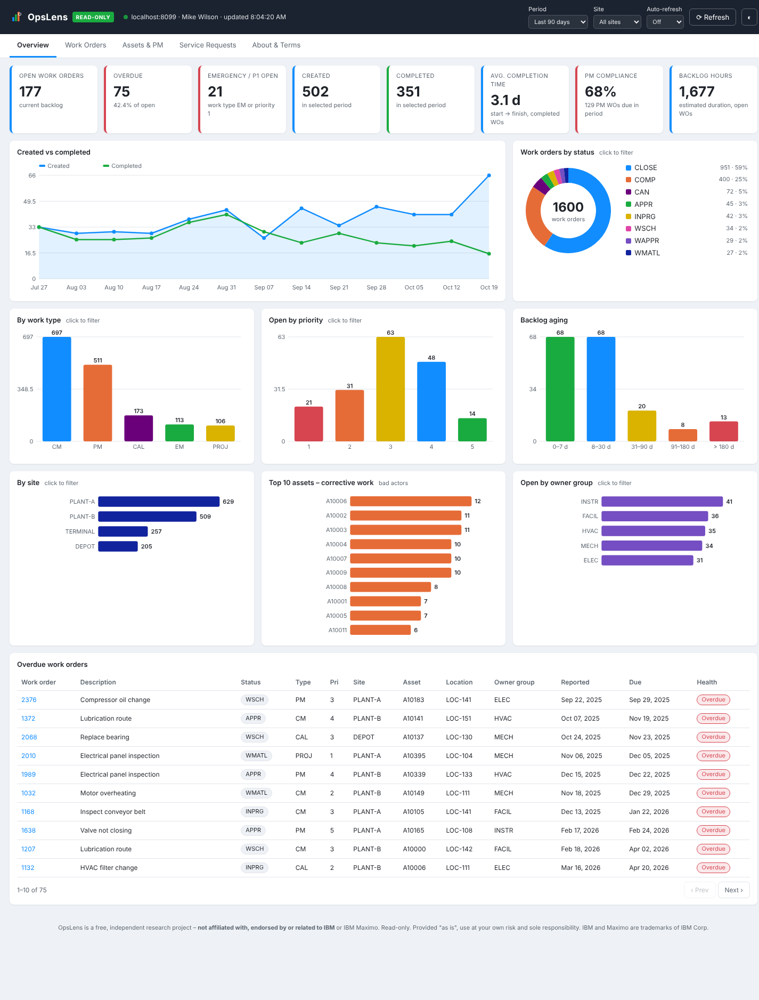
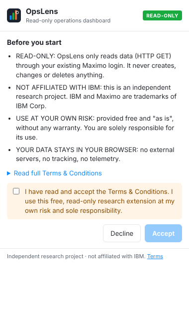
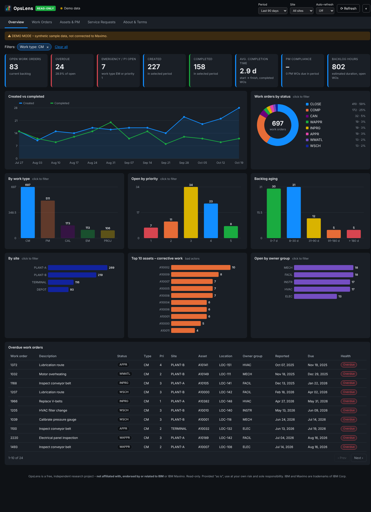

# OpsLens: Read-only Operations Dashboard (for Maximo)

> **⚠️ READ-ONLY · INDEPENDENT RESEARCH PROJECT · NOT AFFILIATED WITH IBM**
>
> OpsLens is a free browser extension that we built ourselves as a research project.
> It is **not** affiliated with, related to, endorsed by or supported by IBM or any IBM Maximo product.
> "IBM" and "Maximo" are trademarks of IBM Corp. and are used here only to say what the extension works with.
> It is provided **"as is", without warranty**. **You use it at your own risk and are solely responsible for how you use it.**
> See [DISCLAIMER.md](DISCLAIMER.md) and the in-app Terms & Conditions.

OpsLens gives you a **Power BI-style operations dashboard** on top of the Maximo you are already logged into.
There's no configuration, no server, and nothing to install inside Maximo. Load the extension in your browser,
open your Maximo tab, and click the icon.



## Features

| Area | What you get |
|---|---|
| **Overview KPIs** | Open backlog, overdue %, emergency/P1 open, created vs completed, average completion time, PM compliance, backlog hours |
| **Interactive charts** | Created-vs-completed trend, status donut, work type, open by priority, backlog aging, by site, top-10 "bad actor" assets, owner groups |
| **Cross-filtering** | Click any bar or slice to filter the whole dashboard, Power BI style. Filter chips can be removed one by one |
| **Work order explorer** | Quick views (Open / Overdue / Emergency / Completed), search, sortable paged table, CSV export |
| **Assets & PM** | Asset status and type, % operating, overdue PMs, PM schedule for the next 4 weeks, PMs by frequency |
| **Service requests** | Created vs closed trend, status, priority, site, average resolution time, open SR list |
| **Convenience** | Period selector (30 days / 90 days / 6 months / 12 months), site filter, auto-refresh, light and dark theme, deep links that open records in Maximo |
| **Demo mode** | Try the dashboard with synthetic data and no Maximo connection |
| **Terms gate** | Users must accept the Terms & Conditions before first use (and again when the terms change) |

<p>


</p>

## Install (any user, no admin rights in Maximo needed)

OpsLens works in **Google Chrome** and **Microsoft Edge** (Manifest V3).

1. Download this repository. Use **Code → Download ZIP** and unzip it, or download `opslens-extension.zip` from the
   [Releases](../../releases) page / the latest **Actions** build.
2. Open `chrome://extensions` (or `edge://extensions`).
3. Turn on **Developer mode**.
4. Click **Load unpacked** and select the folder that contains `manifest.json`.
5. Pin the **OpsLens** icon to your toolbar.

## Use

1. Log in to Maximo as usual (Maximo 7.6.x or Maximo Application Suite / Manage).
2. While you're on the Maximo tab, click the **OpsLens** icon.
3. The first time, read and **accept the Terms & Conditions**.
4. Click **Open Operations Dashboard**. Chrome asks once for permission to read from *your Maximo host only*.
5. Keep the Maximo tab open. The dashboard reads data through it.

To look around without Maximo, click **Open demo (sample data)**.

## How it works (and why it is read-only)

```
 ┌───────────────┐   chrome.scripting   ┌──────────────────────┐  same-origin GET   ┌──────────────┐
 │ OpsLens       │ ───────────────────► │ your Maximo tab      │ ─────────────────► │ Maximo REST  │
 │ dashboard tab │ ◄─────────────────── │ (existing session)   │ ◄───────────────── │ /oslc or /api│
 └───────────────┘     JSON results     └──────────────────────┘     JSON (lean)    └──────────────┘
```

* The extension runs a tiny `fetch(..., { method: 'GET' })` **inside your logged-in Maximo tab**, so it re-uses your
  session and your Maximo security. You only ever see what your account is allowed to see.
* It uses the **standard, out-of-the-box** REST endpoints and object structures (`whoami`, `MXAPIWO`/`MXWO`,
  `MXAPISR`/`MXSR`, `MXAPIASSET`/`MXASSET`, `MXAPIPM`/`MXPM`) and falls back automatically between `/oslc` and `/api`.
  **No configuration, automation script or object structure has to be created in Maximo.**
* The only network function is `MaximoClient.get()` in [`lib/maximo-client.js`](lib/maximo-client.js). It **only issues GET**,
  refuses cross-origin URLs, and never sends a method-override header. There is no code that can create, update or
  delete anything.
* All calculations run in your browser. **No data leaves your machine.** No analytics or telemetry, and no third-party
  scripts or CDNs.
* For large systems, each query is capped at 5,000 records. The dashboard warns you when a cap is reached.

### Permissions

| Permission | Why |
|---|---|
| `activeTab`, `scripting` | Run the read-only GET request inside your Maximo tab |
| `storage` | Remember that you accepted the terms, plus your theme, period and refresh preferences |
| optional host access to *your Maximo host* | Requested when you click **Open dashboard**, for that single host only |

## KPI definitions

| KPI | Definition (computed in the browser) |
|---|---|
| Open work orders | WOs not in COMP / CLOSE / CAN (and `historyflag` false) |
| Overdue | Open WOs whose target completion (or scheduled finish) date has passed |
| Emergency / P1 | Open WOs with work type EM, or priority 1 |
| Avg. completion time | Mean of actual start (or report date) → actual finish, for WOs completed in the period |
| PM compliance | PM-generated WOs due in the period that were completed by the target date (+1 day of grace) |
| Backlog hours | Sum of estimated duration over open WOs |
| Bad actors | Assets with the most non-PM work orders reported in the period |

Status values and work types differ between organisations, so treat all figures as **indicative**
and check them in Maximo before you make decisions.

## Project structure

```
manifest.json            Extension manifest (MV3)
popup/                   Toolbar popup: Terms gate, Maximo detection, launch
terms/                   Full Terms & Conditions page
dashboard/               Dashboard page, controller and table component
lib/maximo-client.js     Read-only REST client (GET only)
lib/loader.js            Loads and merges data from Maximo
lib/analytics.js         KPI and aggregation functions (pure)
lib/charts.js            Dependency-free SVG charts
lib/demo-data.js         Synthetic demo data
lib/terms.js             Terms & Conditions text and acceptance
```

## Contributing

Issues and pull requests are welcome. Please keep the project **read-only**. Pull requests that add any
write operation to Maximo will not be accepted.

## License

[MIT](LICENSE). Also see [DISCLAIMER.md](DISCLAIMER.md) and [PRIVACY.md](PRIVACY.md).
